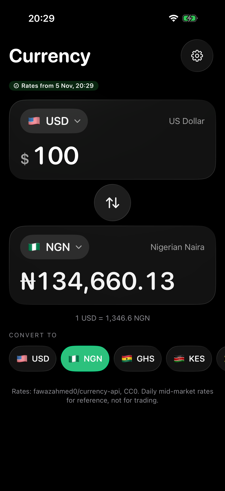
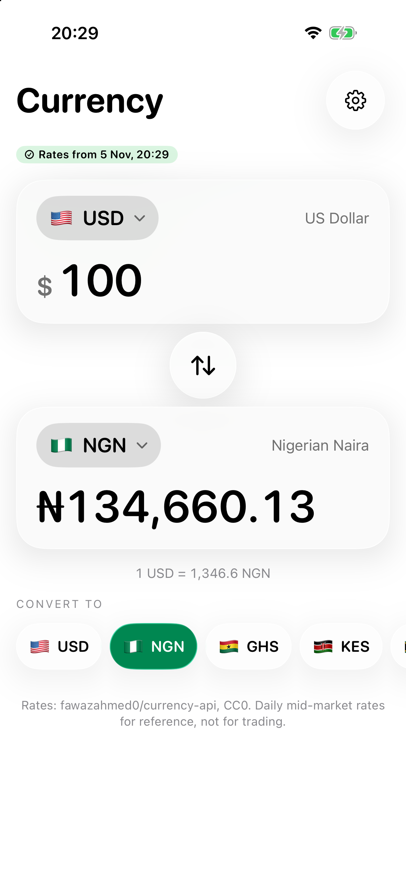
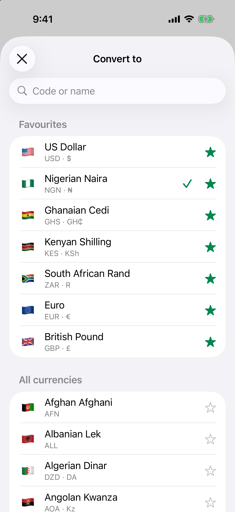
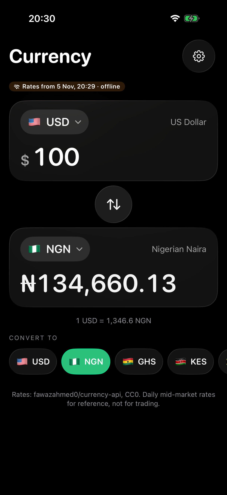
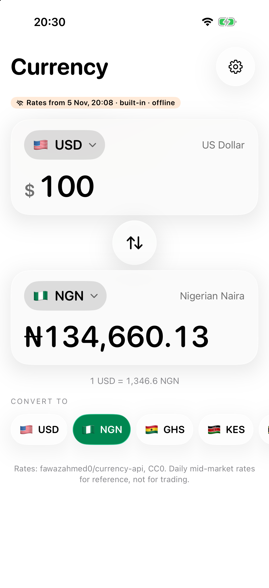
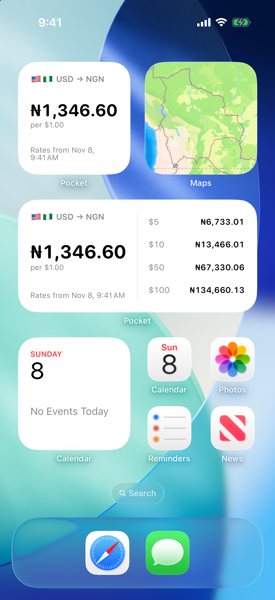
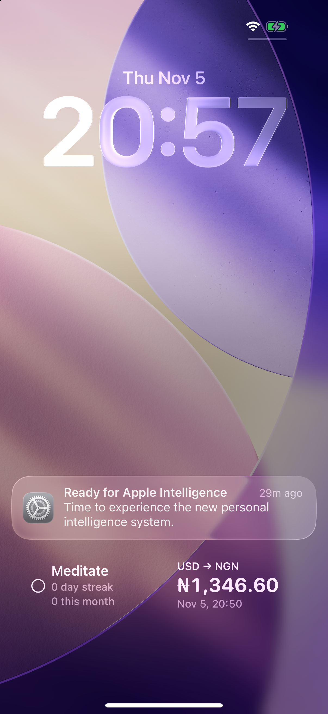

# Pocket

Pocket is a set of small phone tools that work with no signal. The first one is a currency converter.

I grew up without mobile data. The apps I loved were the ones that kept working anyway, like the calculator and the torch. Those apps are why I fell for phones in the first place. Pocket is my go at bringing them back, for kids and adults who grew up offline like I did, and for anyone in airplane mode or on a bad network.

It isn't on the App Store. You clone it, open it in Xcode and run it on your own phone.

## Screenshots

| Converter (dark) | Converter (light) | Currency list |
|---|---|---|
|  |  |  |

| Offline, cached rates | First launch in airplane mode | Widgets |
|---|---|---|
|  |  |  |



The two offline screenshots use the `-PocketOffline` launch argument (see below), which keeps the app off the network completely. The Mac running the Simulator stayed online. For the airplane-mode one, I deleted the app, reinstalled it and opened it with that flag, so it had no cache and fell back to the rates it ships with.

## What the currency tool does

- Type an amount and the result updates as you go, with each currency's own symbol and decimals: ₦134,660.13, GH₵1,234.50, KSh 1,000.00, ¥1,235, BD 1.235. Number formatting follows your phone's region.
- It opens on USD → NGN. Tap a currency to change it, or tap the swap button between them.
- The chips under the result are your favourites, then the currencies you used most recently.
- The currency list covers 155 currencies with flag, name, code and symbol. You can search it by code or name, and starred favourites stay pinned at the top.
- The age of the rates is always on screen, for example "Rates from 5 Nov, 09:14 · offline". Rates are never shown as current unless the phone is online and they were downloaded in the last 24 hours.
- Widgets: small and medium on the Home Screen, and a rectangular one for the Lock Screen. They show your default pair and how old the rate is, and they work offline.
- Settings cover the default pair, decimal places (auto, 0 or 2) and haptics.

### How it stays useful offline

1. The app ships with a snapshot of rates (`Shared/rates-snapshot.json`), so the first launch works with no network. The label then says "built-in".
2. Every download is saved to the App Group container, so the app and the widgets read the same file.
3. On launch, when the app comes back to the foreground, and on pull-to-refresh, Pocket tries to download new rates. If that fails, it says nothing and keeps the rates it has. `NWPathMonitor` tells it whether the phone is online.
4. When both a cache and the bundled snapshot exist, the newer one wins. An old cache won't beat the snapshot in a freshly built app.

## Build and run

You need Xcode 27 and a phone or simulator on iOS 26.1 or later. There are no packages and no API keys.

```bash
git clone <this repo>
cd pocket
open Pocket.xcodeproj
```

Pick the Pocket scheme and a simulator (I use iPhone 17 Pro), then press Run. You don't need to set up signing for the Simulator.

### On your own iPhone

1. Open `Config/Pocket.xcconfig` and set `POCKET_BUNDLE_PREFIX` to something that's yours, such as `com.yourname`. The bundle IDs and the App Group (`group.<prefix>.pocket`) are all built from it, so they always match.
2. Set `DEVELOPMENT_TEAM` there to your Team ID, or choose your team under Signing & Capabilities for both the Pocket and PocketWidget targets.
3. Plug in your phone, select it and press Run. The first time, go to Settings › General › VPN & Device Management on the phone and trust your developer certificate.

A note on accounts: with a free Apple ID, an app you install from Xcode stops opening after 7 days. Run it from Xcode again and you get another 7, and your favourites and cached rates survive the reinstall. With a paid Apple Developer Program membership the install lasts a year.

If signing fails on the App Group, remove the App Groups capability from both targets. The app still works, but the widgets will show the built-in rates instead of your latest download.

### Tests

```bash
xcodebuild test -scheme Pocket -destination 'platform=iOS Simulator,name=iPhone 17 Pro,OS=26.1'
```

The 59 tests in `PocketTests` cover the pure logic: converting through the base currency, cross rates, rounding per currency, parsing the API payload and the bundled snapshot, reading and writing the cache, choosing between bundled and cached rates by date, the "out of date" and "offline" labels, and formatting for NGN, GHS, JPY (no decimals) and BHD (three). Leave out `OS=26.1` if your iPhone 17 Pro simulator runs the newest iOS.

### Launch arguments (Debug builds)

Both are in the scheme, switched off. Turn them on under Product › Scheme › Edit Scheme › Run › Arguments.

- `-PocketOffline` makes the app act as if the phone has no network. It never makes a request, and the label says "offline". Use it to check the cached and built-in paths without turning off your Mac's Wi-Fi.
- `-PocketOpenPicker` opens the currency list on launch.
- `-PocketNoSplash` skips the opening animation and opens straight on the converter.
- `-PocketSplashSlow` plays the opening animation 4× slower. `scripts/record-splash.sh` records it at both speeds in the Simulator and opens the videos.

## Rates source

Rates come from [fawazahmed0/currency-api](https://github.com/fawazahmed0/exchange-api). It's free, needs no key, has no rate limits and updates daily. Pocket uses the jsDelivr endpoint and falls back to the project's Cloudflare mirror. It covers NGN, GHS, KES, ZAR, EGP, XOF, XAF and every other currency in the app.

The data is released under CC0 1.0, so attribution isn't required. Pocket credits it anyway, on the converter screen, in Settings and here. CC0 is also why the starter snapshot can ship inside the repo.

I looked at ExchangeRate-API's open endpoint (`open.er-api.com`) too. It covers the same currencies, but [its terms](https://www.exchangerate-api.com/docs/free) allow caching while forbidding redistribution, and committing a snapshot of its data to a public repo would be redistribution.

These are daily mid-market rates. Banks and bureaux add their own spread, so expect the rate you get at the counter to be a bit worse.

To refresh the bundled snapshot before a release:

```bash
python3 scripts/update-snapshot.py
```

## Project layout

```
Pocket/            the app: tools, settings, components from swiftui-registry
  Currency/        ConverterView, CurrencyPickerSheet, RatesStore, RatesClient, ConnectivityMonitor
Shared/            in both the app and the widget: ConversionLogic, RatesModel,
                   PocketPersistence, CurrencyCatalog, Theme, Tokens, rates-snapshot.json
PocketWidget/      Home Screen and Lock Screen widgets
PocketTests/       Swift Testing suites for the shared logic
Config/            Pocket.xcconfig (bundle prefix, team), entitlements, Info.plists
```

Each tool is a case of `PocketTool` in `PocketApp.swift`. Add a case and its view and the tab bar appears. While there's only one tool, it stays hidden.

## Roadmap

1. Currency converter (this release)
2. Unit converter, for length, weight, temperature, volume and cooking measures
3. QR scanner that reads codes on the phone and never sends them anywhere
4. Flashlight with a Morse code mode, for sending messages by light

## License

MIT. See [LICENSE](LICENSE).
